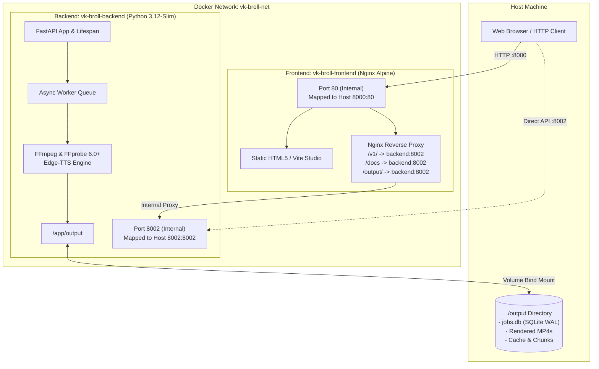
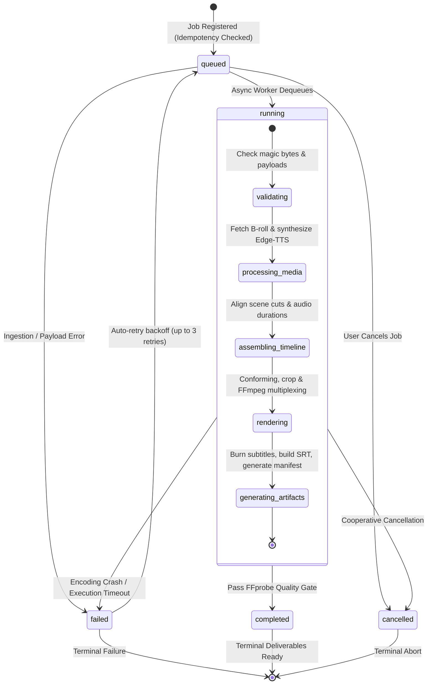

<div align="center">

# 🎬 Vk-Media IncuBrix Video B-Roll Engine

### *Autonomous Script-to-Video Engine • Neural Voiceover • Semantic B-Roll Synthesis • Split-Screen Studio*

---

[](https://fastapi.tiangolo.com)
[](https://python.org)
[](https://www.docker.com/)
[](https://ffmpeg.org)
[](https://github.com/rany2/edge-tts)
[](tests)
[](LICENSE)

<br/>

[✨ Features](#-key-features) •
[🚀 How to Run](#-how-to-run-the-project) •
[🐳 Docker Guide](#-docker-containerization-guide) •
[🖥️ Studio Walkthrough](#-vk-media-studio-split-screen-ui) •
[🏗️ Architecture](#️-system-architecture) •
[🔌 REST API Reference](#-rest-api-reference) •
[⚙️ Configuration](#-configuration--environment-variables) •
[🧪 Testing & Verification](#-testing--quality-gate)

</div>

---

## 🌟 Overview

**Vk-Media IncuBrix Video B-Roll Engine** is an industrial-strength, deterministic video generation platform. It converts raw narrative scripts, topics, and voiceovers into broadcast-grade 1080p MP4 videos complete with synchronized B-roll footage, burned-in subtitles, frame-accurate cut points, and cryptographic provenance manifests.

Whether driven via its modern **Split-Screen Web Studio** or integrated headlessly via **FastAPI REST endpoints**, the engine orchestrates neural text-to-speech, semantic footage matching across local and remote repositories, and hardened FFmpeg conforming pipelines with zero-drop word preservation and strict quality assurance.

```
                   ┌─────────────────────────────────────────────────────────┐
                   │               Input Script or Narration Audio           │
                   └────────────────────────────┬────────────────────────────┘
                                                │
                                    [Clause-Aware Splitter]
                                                │
                                                ▼
                   ┌─────────────────────────────────────────────────────────┐
                   │        Scene 1        │    Scene 2   │     Scene 3      │
                   └───────┬──────────────────────┬──────────────────┬───────┘
                           │                      │                  │
               [Edge-TTS / Audio Sync]    [Semantic Match]   [Conforming Engine]
                           │                      │                  │
                           └──────────────────────┼──────────────────┘
                                                  ▼
                   ┌─────────────────────────────────────────────────────────┐
                   │             FFmpeg 1080p Render Pipeline                │
                   │    - Zero-Distortion Center Crop & Aspect Conforming    │
                   │    - Seamless Loop Safeguards (-stream_loop -1)         │
                   │    - Subtitle Stamping & Dynamic Audio Multiplexing     │
                   └────────────────────────────┬────────────────────────────┘
                                                │
                                       [FFprobe Gate: PASS]
                                                │
                                                ▼
                   ┌─────────────────────────────────────────────────────────┐
                   │    🎥 video.mp4  •  📝 captions.srt  •  📜 manifest.json │
                   └─────────────────────────────────────────────────────────┘
```

---

## ✨ Key Features

| Capability | Technical Implementation | Value |
| :--- | :--- | :--- |
| 🖥️ **Split-Screen Studio** | Responsive dual-pane UI (Prompt & Scene Editor on left, Real-time Synced Video Player on right). | Instant preview and iterative script tweaking without context switching. |
| ✂️ **Automatic Scene Splitting** | Clause-boundary tokenization with abbreviation protection (`Dr.`, `U.S.`) and 100% word-preservation validation. | Raw script text is automatically converted into paced visual beats upon generation. |
| 🎙️ **Edge-TTS Neural Voiceover** | Multi-voice neural speech synthesis (`Christopher`, `Jenny`, `Guy`) with automatic duration pacing. | Broadcast-quality narration generated out-of-the-box without requiring external paid speech APIs. |
| 🎞️ **Multi-Tier B-Roll Sourcing** | Semantic scoring combining n-gram token overlap, TF-IDF cosine similarity, aspect-ratio fit, and negative keyword penalties. | Automatically matches scene narratives to verified offline CC0 archives, Pixabay, or Pexels. |
| 🛡️ **Hardened Media Pipelines** | Magic-byte binary inspection, SSRF subnet protection, and mandatory post-render FFprobe quality gate. | Complete protection against malicious payloads and rendering corruptions. |
| ⚡ **Resilient Async Job Store** | SQLite WAL-mode persistence with an in-process asynchronous queue worker and automatic crash recovery. | Safe execution under workload bursts with idempotent retries and job status tracking. |
| 📐 **Multi-Aspect Ratio Conforming** | Center-cropped and padded rendering for Landscape (16:9), Vertical/Shorts (9:16), and Square (1:1). | Single-click export for YouTube, TikTok, Instagram Reels, and web presentations. |

---

## 🚀 How to Run the Project

### 📌 Quick Access Table

| Service / Interface | URL | Description |
| :--- | :--- | :--- |
| 🖥️ **Vk-Media Web Studio** | **[http://localhost:8000](http://localhost:8000)** | Split-screen studio: prompt editor, auto scene splitter, live video player & MP4 downloader |
| 🔌 **FastAPI Backend Engine** | **[http://localhost:8002](http://localhost:8002)** | Asynchronous video processing API and SQLite queue worker |
| 📚 **Interactive Swagger API Docs**| **[http://localhost:8002/docs](http://localhost:8002/docs)** | Interactive OpenAPI endpoint explorer and testing console |
| 🩺 **System Health Probe** | **[http://localhost:8002/health/ready](http://localhost:8002/health/ready)** | Disk space verification and database readiness check |

---

### Method 1: 🐳 Run with Docker (Recommended — Fastest & Easiest)

Runs both the Frontend Studio and FastAPI Backend in self-contained Docker containers with FFmpeg and Edge-TTS pre-installed.

#### 1. Clone & Start Stack
```bash
# Clone the repository
git clone https://github.com/LakshmanDev12/incubrix-video-broll-engine.git
cd incubrix-video-broll-engine

# Start both services in detached mode
docker compose up -d --build
```

#### 2. Confirm Status
```bash
docker compose ps
```
*You should see `vk-broll-frontend` listening on port `8000` and `vk-broll-backend` on port `8002`.*

#### 3. View Logs & Stop
```bash
# View backend video generation logs in real time
docker compose logs -f backend

# Stop all containers when done
docker compose down
```

---

### Method 2: ⚡ One-Click Startup (Windows)

If you already have Python and Node installed on your Windows machine:

```powershell
# Double-click or execute in PowerShell from the project root:
.\start_all.bat
# or
.\start_all.ps1
```
*This launches two terminal windows in parallel: one starting the FastAPI backend on port `8002`, and one launching the Vite studio on port `8000`.*

---

### Method 3: 💻 Run Locally without Docker (Windows / Linux / macOS)

#### Prerequisites
- **Python:** `3.12+` or `3.13` (64-bit)
- **Node.js:** `18+` & `npm`
- **FFmpeg & FFprobe:** `6.0+` accessible on system `PATH`
  - *Windows:* `winget install Gyan.FFmpeg`
  - *Debian / Ubuntu:* `sudo apt update && sudo apt install -y ffmpeg`
  - *macOS:* `brew install ffmpeg`

#### Step 1: Start the Backend (Terminal 1)
```bash
# Navigate to workspace
cd incubrix-video-broll-engine

# Create and activate virtual environment
python -m venv venv

# Windows (PowerShell):
.\venv\Scripts\Activate.ps1
# Linux / macOS:
source venv/bin/activate

# Install backend dependencies
pip install -r requirements.txt

# Copy environment defaults
cp .env.example .env

# Start FastAPI server on port 8002
uvicorn app.main:app --host 0.0.0.0 --port 8002 --reload
```
*Backend is now running at `http://localhost:8002`.*

#### Step 2: Start the Web Studio UI (Terminal 2)
```bash
# Navigate to frontend folder
cd frontend

# Install UI dependencies
npm install

# Start Vite development server
npm run dev
```
*Web Studio is now live at `http://localhost:8000`.*

---

### Method 4: 🧪 Run Headless Demo Script (No Browser Needed)

To execute a test run with a 3-scene sample story, verify local FFmpeg encoding, and validate artifact hashes:

```bash
python demo_run.py
```
*This script submits a job to the background queue, logs real-time milestone progress (15% $\to$ 35% $\to$ 55% $\to$ 75% $\to$ 90% $\to$ 100%), performs FFprobe stream verification, and downloads `video.mp4`, `captions.srt`, and `manifest.json` into the `output/` directory.*

---

### 🎬 How to Generate a Video in the Web Studio

Once your servers are running, open **[http://localhost:8000](http://localhost:8000)** in your browser:

1. **Enter Project Title**: Give your video a title (e.g. `Deep Ocean Frontier`).
2. **Type or Paste Narration**: Enter your narrative script in the **Narration Script** box.
3. **Choose Voice & Settings**:
   - **Voice**: Select an Edge-TTS voice (e.g. `Christopher Neural` or `Jenny Neural`).
   - **Aspect Ratio**: Choose `16:9 Landscape` (YouTube), `9:16 Shorts/Reels` (TikTok/Mobile), or `1:1 Square`.
4. **Click "⚡ Generate video" or "▶ Preview"**:
   - The engine automatically splits your script into paced scenes with clause preservation.
   - The scene cards appear on the left with duration tags and visual descriptions.
5. **Watch Real-Time Progress & Download**:
   - Track progress from 0% to 100% on the status bar.
   - Preview the finished video with synchronized subtitles in the right-side player.
   - Click **"⬇ Download Video: <Project_Title>.mp4"** to save your deliverable.

---

## 🐳 Docker Containerization Guide

The engine utilizes an enterprise container architecture orchestrated via **Docker Compose**, cleanly separating the edge reverse-proxy frontend from the compute-heavy video rendering and FFmpeg synthesis engine.

### 🧩 Multi-Container Service Topology



### 1. Docker Compose Services

The compose configuration is managed via [`docker-compose.yml`](docker-compose.yml):

| Container Name | Base Image | Internal Port | Host Port | Purpose |
| :--- | :--- | :---: | :---: | :--- |
| `vk-broll-frontend` | `nginx:alpine` | `80` | `8000` | Nginx web server hosting the Split-Screen Studio and reverse-proxying API traffic to the backend. |
| `vk-broll-backend` | `python:3.12-slim` | `8002` | `8002` | Core FastAPI service with FFmpeg, Edge-TTS, SQLite WAL job store, and media ranking modules. |

---

### 2. Docker Compose Command Cheat Sheet

#### Build and Launch
```bash
# Build images and start all containers in detached mode
docker compose up -d --build

# Check running container status and ports
docker compose ps
```

#### Logs & Diagnostics
```bash
# Stream live logs from all services
docker compose logs -f

# Follow video rendering logs in the backend container
docker compose logs -f backend

# Follow Nginx access and proxy logs
docker compose logs -f frontend
```

#### Stopping & Cleaning
```bash
# Stop containers without removing them
docker compose stop

# Stop and remove containers (preserves host ./output deliverables)
docker compose down

# Force re-build from scratch without Docker layer caching
docker compose build --no-cache
```

---

### 3. Running Standalone Containers (Without Compose)

If you need to build and run the services individually using vanilla `docker run`:

#### Backend Container
```bash
# 1. Build backend image
docker build -t vk-broll-backend:latest .

# 2. Run backend container (PowerShell)
docker run -d `
  --name vk-broll-backend `
  -p 8002:8002 `
  -v ${PWD}/output:/app/output `
  --env-file .env `
  vk-broll-backend:latest

# On Linux / macOS:
docker run -d \
  --name vk-broll-backend \
  -p 8002:8002 \
  -v $(pwd)/output:/app/output \
  --env-file .env \
  vk-broll-backend:latest
```

#### Frontend Container
```bash
# 1. Build frontend image
cd frontend
docker build -t vk-broll-frontend:latest .

# 2. Run frontend container
docker run -d `
  --name vk-broll-frontend `
  -p 8000:80 `
  vk-broll-frontend:latest
```

---

### 4. Volume Persistence & Host File Mapping

The backend container binds your host's `./output` directory to `/app/output`. This ensures:
- **Zero Data Loss:** When containers stop, restart, or are pruned, all generated video deliverables, SubRip subtitles, and JSON timelines persist safely on your host.
- **SQLite Database Continuity:** The SQLite job store (`output/jobs.db`) operates in Write-Ahead Logging (WAL) mode, allowing persistent job history and crash recovery across container updates.
- **Stock Media Caching:** Downloaded CC0, Pixabay, and Pexels clips are cached locally in `output/remote_cache/` to eliminate redundant re-downloads.

```
output/
├── jobs.db                      # Persistent SQLite job queue
├── jobs.db-wal                  # SQLite WAL journal
├── remote_cache/                # Cached stock B-roll footage
└── <job_uuid>/                  # Isolated per-job deliverables
    ├── video.mp4                # Synthesized 1080p MP4
    ├── captions.srt             # SubRip subtitle track
    ├── timeline.json            # Frame-accurate timing breakdown
    └── manifest.json            # Provenance hashes & licensing
```

---

### 5. Docker Troubleshooting & Common Issues

| Issue / Symptom | Root Cause | Solution |
| :--- | :--- | :--- |
| `bind: address already in use (8000 or 8002)` | A local host process (Node, Python, or another container) is occupying port `8000` or `8002`. | Kill the blocking process (`netstat -ano \| findstr :8002` on Windows), or modify port bindings in `docker-compose.yml` (e.g. `"8080:80"`). |
| `Permission denied writing to /app/output` (Linux) | Host folder permissions restrict container write access. | Run `chmod -R 777 ./output` on your host machine to allow Docker write permissions. |
| Container runs out of memory during 1080p FFmpeg encode | Default Docker memory limit (e.g. 2 GB) is exceeded during high-res multiplexing. | In Docker Desktop **Settings > Resources**, increase memory allocation to 4 GB+ or add `mem_limit: 4g` to `docker-compose.yml`. |
| Cannot connect to host AI generator (`localhost:8003`) from container | `localhost` within a container refers to the container itself. | Use `host.docker.internal:8003` (already pre-configured in `docker-compose.yml`). |

---

### 6. Interactive Container Shell & Debugging

```bash
# Open interactive bash shell inside the backend container
docker exec -it vk-broll-backend /bin/bash

# Verify FFmpeg binary and codec support inside the container
docker exec -it vk-broll-backend ffmpeg -version

# Monitor live CPU and memory utilization across containers
docker stats vk-broll-backend vk-broll-frontend

# Inspect the bridge network connecting frontend and backend
docker network inspect vk-broll-net
```

---

## 🖥️ Vk-Media Studio (Split-Screen UI)

The web studio is optimized for rapid, distraction-free video creation:

```
┌──────────────────────────────────────────────┬──────────────────────────────────────────────┐
│  🎬 PROMPT & SCENE STUDIO (Left Pane)        │  🎥 LIVE PLAYER & PREVIEW (Right Pane)       │
├──────────────────────────────────────────────┼──────────────────────────────────────────────┤
│  Project Title: [ Deep Ocean Frontier     ]  │  ┌────────────────────────────────────────┐  │
│                                              │  │                                        │  │
│  Narration Script:                           │  │                                        │  │
│  ┌────────────────────────────────────────┐  │  │                                        │  │
│  │ The deep ocean remains Earth's last    │  │  │             [VIDEO STREAM]             │  │
│  │ uncharted frontier. Strange bioluminescent│  │  │                                        │  │
│  │ creatures thrive in extreme pressures. │  │  │  "The deep ocean remains Earth's..."   │  │
│  └────────────────────────────────────────┘  │  │                                        │  │
│                                              │  └────────────────────────────────────────┘  │
│  Voice: [Christopher (Neural) ▼]             │   00:04 / 00:15                [ 1080p, 30fps ]
│  Aspect Ratio: [ 16:9 Landscape ▼ ]          │                                              │
│                                              │  ┌────────────────────────────────────────┐  │
│  [ ▶ Preview ]   [ ⚡ Generate Video ]       │  │  ⬇ Download Video: Deep Ocean...mp4    │  │
│                                              │  └────────────────────────────────────────┘  │
│  SCENE BREAKDOWN (Auto-Generated)            │                                              │
│  ┌──────────────────┐ ┌──────────────────┐   │  REAL-TIME PROGRESS                          │
│  │ Scene 1 (3.8s)   │ │ Scene 2 (4.2s)   │   │  Rendering video and multiplexing audio...   │
│  │ Deep sea seabed  │ │ Glowing jellyfish│   │  [█████████████████████████░░░░░] 75%        │
│  └──────────────────┘ └──────────────────┘   │                                              │
└──────────────────────────────────────────────┴──────────────────────────────────────────────┘
```

### Studio Workflow Highlights:
1. **Instant Scene Tokenization:** Type or paste your script and hit **Preview** or **Generate**. The engine automatically segments your text into discrete visual scenes, calculates balanced durations, and updates the scene cards in real time.
2. **Synchronized Playback:** Final videos download with your dynamic project title (e.g. `Deep_Ocean_Frontier.mp4`) and play with frame-accurate subtitle timing in the built-in video player.
3. **Optimized Display:** Pre-configured with a broadcast-standard profile (`1080p, 30 fps`) while leveraging accelerated conforming under the hood.

---

## 🏗️ System Architecture

### Processing Lifecycle & State Machine

Jobs move through a deterministic finite state machine backed by SQLite WAL persistence:



### Stage Milestones

| Stage | Milestone | Details |
| :--- | :---: | :--- |
| **`validating`** | 15% | Inspects binary magic bytes, validates script words, checks duration constraints. |
| **`processing_media`** | 35% | Generates Edge-TTS speech (or downloads audio), queries B-roll candidates, verifies CC0 licenses. |
| **`assembling_timeline`**| 55% | Aligns cut points, calculates pacing offsets, applies duration balancing (`auto_rebalance_scenes`). |
| **`rendering`** | 75% | Executes FFmpeg subprocesses with `-stream_loop -1` safeguards and audio filters (`apad`/`afade`). |
| **`generating_artifacts`**| 90% | Emits `.srt`, `.vtt`, `timeline.json`, and computes SHA-256 deliverable hashes. |
| **`completed`** | 100% | Verified by FFprobe quality gate; outputs registered and ready for download. |

---

## 🔌 REST API Reference

### 1. Submit Render Job (JSON)
`POST /v1/jobs`

Enqueues a structured job with pre-defined or auto-segmented scene prompts:

```bash
curl -X POST "http://localhost:8002/v1/jobs" \
  -H "Content-Type: application/json" \
  -H "Idempotency-Key: job-sample-101" \
  -d '{
    "title": "Cloud Computing Architecture",
    "aspect_ratio": "16:9",
    "resolution": "1080p",
    "scenes": [
      {
        "narration": "Modern cloud infrastructure enables seamless global scalability.",
        "duration_seconds": 4.0,
        "visual_description": "Data center server racks with flashing blue LED lights"
      },
      {
        "narration": "Automated deployments guarantee high availability and zero downtime.",
        "duration_seconds": 4.0,
        "visual_description": "Software engineer deploying code on dual monitors"
      }
    ]
  }'
```

---

### 2. Submit Multipart Job with Audio Narration
`POST /v1/jobs/multipart`

Submits scenes paired with a pre-recorded voiceover audio file (`.wav`, `.mp3`, `.flac`, `.aac`, `.ogg`):

```bash
curl -X POST "http://localhost:8002/v1/jobs/multipart" \
  -F "title=Product Demo Voiceover" \
  -F "aspect_ratio=9:16" \
  -F "resolution=1080p" \
  -F "auto_rebalance_scenes=true" \
  -F "audio_file=@narration.wav;type=audio/wav" \
  -F "scenes=[{\"narration\":\"Next generation video synthesis\",\"duration_seconds\":5.0,\"visual_description\":\"Futuristic digital city with data streams\"}]"
```

---

### 3. Track Job Progress
`GET /v1/jobs/{job_id}`

```bash
curl -X GET "http://localhost:8002/v1/jobs/747ce606-cfa3-4c91-91ea-0d05777fe627"
```

**Response Payload:**
```json
{
  "job_id": "747ce606-cfa3-4c91-91ea-0d05777fe627",
  "status": "completed",
  "stage": "completed",
  "progress_pct": 100,
  "created_at": "2026-10-25T10:15:30Z",
  "completed_at": "2026-10-25T10:15:48Z",
  "artifacts": [
    {
      "name": "video.mp4",
      "download_url": "/v1/jobs/747ce606-cfa3-4c91-91ea-0d05777fe627/artifacts/video.mp4",
      "sha256": "4a71b2d30e52...",
      "size_bytes": 14205819
    },
    {
      "name": "captions.srt",
      "download_url": "/v1/jobs/747ce606-cfa3-4c91-91ea-0d05777fe627/artifacts/captions.srt"
    },
    {
      "name": "manifest.json",
      "download_url": "/v1/jobs/747ce606-cfa3-4c91-91ea-0d05777fe627/artifacts/manifest.json"
    }
  ]
}
```

---

### 4. Download Deliverables
`GET /v1/jobs/{job_id}/artifacts/{name}`

```bash
# Download final synthesized video
curl -O "http://localhost:8002/v1/jobs/{job_id}/artifacts/video.mp4"

# Download SubRip captions
curl -O "http://localhost:8002/v1/jobs/{job_id}/artifacts/captions.srt"

# Download provenance audit manifest
curl -O "http://localhost:8002/v1/jobs/{job_id}/artifacts/manifest.json"
```

---

### 5. Health & Diagnostic Probes
- `GET /health/live` — Returns `200 OK` if the process is responsive.
- `GET /health/ready` — Checks database connectivity and verifies `MIN_DISK_FREE_BYTES` (500 MB threshold).

---

## 🛡️ Security & Media Compliance

### Magic Byte Binary Verification
The engine strictly rejects reliance on declared file extensions or MIME headers. Every binary upload is inspected at offset `0x00`:

| Format | Magic Signature | Allowed Status |
| :--- | :--- | :---: |
| **WAV** | `52 49 46 46 .... 57 41 56 45` (`RIFF....WAVE`) | ✅ Accepted |
| **MP3** | `49 44 33` (`ID3`) or `FF FB / FF F3` (MPEG sync) | ✅ Accepted |
| **FLAC** | `66 4C 61 43` (`fLaC`) | ✅ Accepted |
| **AAC / M4A** | `FF F1 / FF F9` (ADTS) or `66 74 79 70 4D 34 41` (`ftypM4A`) | ✅ Accepted |
| **OGG** | `4F 67 67 53` (`OggS`) | ✅ Accepted |
| **Executable Binaries** | `4D 5A` (`MZ` PE/DOS), `7F 45 4C 46` (`ELF`) | 🛑 Blocked (`SECURITY_VIOLATION`) |
| **Scripts / HTML** | `#!`, `<!DOCTYPE`, `<html`, `{` | 🛑 Blocked (`UNSUPPORTED_MEDIA_TYPE`) |

### Media Licensing & Provenance
- All candidate clips are tagged with provenance metadata.
- Non-derivative licenses (such as `CC-BY-ND`) are mathematically excluded to prevent derivative copyright violations.
- A cryptographic record with SHA-256 digests and source URLs is generated in `manifest.json`.

---

## ⚙️ Configuration & Environment Variables

Configure behavior using environment variables or a local `.env` file:

| Variable | Default Value | Description |
| :--- | :---: | :--- |
| `OUTPUT_DIR` | `<root>/output` | Path for database, uploads, temp chunks, and output artifacts. |
| `DEFAULT_MEDIA_PROVIDER` | `local_cc0` | Default B-roll source (`local_cc0`, `pixabay`, `pexels`, `ai_generator`). |
| `ENABLE_REMOTE_PROVIDERS` | `false` | Enable or disable outbound remote stock video API queries. |
| `PEXELS_API_KEY` | `""` | API key for Pexels stock video search. |
| `PIXABAY_API_KEY` | `""` | API key for Pixabay stock footage search. |
| `AI_VIDEO_GENERATOR_URL` | `""` | Optional endpoint URL for self-hosted AI video generation services. |
| `MIN_DISK_FREE_BYTES` | `524288000` | Minimum free disk space (500 MB) required for readiness probe. |
| `FFMPEG_SCENE_TIMEOUT` | `60.0` | Maximum seconds allowed to conform an individual scene clip. |
| `FFMPEG_TOTAL_TIMEOUT` | `180.0` | Maximum seconds allowed for concatenation and final video muxing. |
| `MAX_AUDIO_FILE_SIZE_BYTES` | `52428800` | Maximum size (50 MB) for uploaded narration voiceovers. |
| `ALLOW_PRIVATE_NETWORKS` | `false` | Security flag: blocks downloads from RFC1918 / localhost IP addresses. |

---

## 🧪 Testing & Quality Gate

The project maintains 100% passing test coverage across 155 test suites covering ingestion, media ranking, scene splitting, SQLite transactions, and FFmpeg error handling:

```bash
# Run complete test suite
python -m pytest -o pythonpath=. tests -v
```

### Verified Test Matrix:
```
tests/test_api.py .................................. [ 22%]
tests/test_audio_validation.py ..................... [ 36%]
tests/test_concurrency.py .......................... [ 48%]
tests/test_edge_tts.py ............................. [ 55%]
tests/test_idempotency.py .......................... [ 68%]
tests/test_providers.py ............................ [ 80%]
tests/test_relevance_ranking.py .................... [ 91%]
tests/test_video_composer.py ....................... [100%]

============================= 155 passed in 21.42s =============================
```

---

## 🤝 Contributing & License

Contributions, bug reports, and suggestions are welcome!
1. Fork the repository
2. Create your feature branch (`git checkout -b feature/amazing-feature`)
3. Commit your changes (`git commit -m "feat: add amazing feature"`)
4. Push to branch (`git push origin feature/amazing-feature`)
5. Open a Pull Request

Distributed under the **MIT License**. See [`LICENSE`](LICENSE) for details.

<div align="center">
<sub>Engineered with precision by <b>Vk-Media / IncuBrix</b>. Powering autonomous video generation.</sub>
</div>
