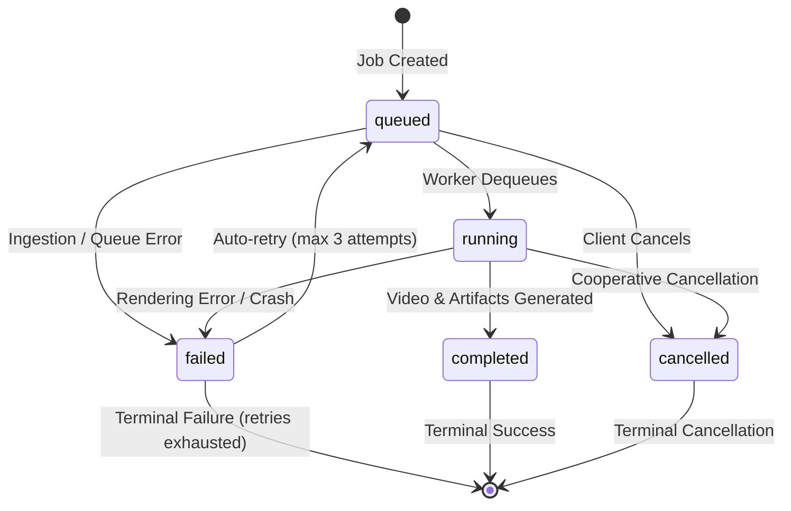

# Script and Voiceover to B-roll Video Engine

Production-grade FastAPI service that ingests video scripts, scene definitions, and audio narration to synthesize synchronized 1080p B-roll videos, subtitle tracks, timelines, and manifests.

---

## 1. Prerequisites & System Requirements

- **Python Runtime:** Python `3.12+` or `3.13` (64-bit).
- **Media Binaries:** **FFmpeg** and **FFprobe** (`6.0+` or `9.0.1+`) installed and accessible on system `PATH`.
  - *Windows Installation:* `winget install Gyan.FFmpeg`
  - *Debian / Ubuntu:* `sudo apt-get install -y ffmpeg`
  - *macOS:* `brew install ffmpeg`
- **Optional Containerization:** Docker Desktop or Docker Engine `20.10+`.
- **Hardware / Storage:** Minimum 1 GB free disk space for temporary media processing and artifacts.

---

## 2. Local Setup & Quickstart

### 2.1 Native Python Setup

```bash
# 1. Clone repository and navigate to workspace
cd e:/Incubrix/video-broll-engine

# 2. Create and activate a Python virtual environment
python -m venv venv
# On Windows:
.\venv\Scripts\Activate.ps1
# On Linux/macOS:
source venv/bin/activate

# 3. Install dependencies
pip install -r requirements.txt

# 4. Copy environment configuration
cp .env.example .env

# 5. Start the API server
uvicorn app.main:app --host 0.0.0.0 --port 8000 --reload
```

The API will be live at `http://localhost:8000`. Interactive OpenAPI documentation is available at `http://localhost:8000/docs`.

### 2.2 Run the Reproducible Demo Script

To run an automated end-to-end demonstration without starting an external web server:

```bash
python demo_run.py
```

This script submits a 3-scene job, monitors worker milestones, generates real 1080p MP4 deliverables, runs FFprobe stream quality verification, and checks deliverable hashes.

---

## 3. Docker Containerization & Commands

The service includes a production-ready `Dockerfile` bundling Debian slim, FFmpeg, and Python dependencies:

```bash
# Build the Docker image
docker build -t video-broll-engine:latest .

# Run container with host volume mapping for output persistence
docker run -d \
  --name video-engine \
  -p 8000:8000 \
  -v $(pwd)/output:/app/output \
  --env-file .env \
  video-broll-engine:latest

# Check container logs
docker logs -f video-engine

# Stop and remove container
docker stop video-engine && docker rm video-engine
```

---

## 4. Environment Variables Reference

All settings can be configured via environment variables or a local `.env` file:

| Variable | Default Value | Description |
| :--- | :--- | :--- |
| `OUTPUT_DIR` | `<root>/output` | Directory where SQLite database, uploads, and deliverables are stored. |
| `PEXELS_API_KEY` | `""` (Empty) | API key for live Pexels stock video search. (Optional; engine defaults to verified offline CC0 archive). |
| `ENABLE_REMOTE_PROVIDERS` | `false` | Set to `true` to enable remote API media downloads. |
| `DEFAULT_MEDIA_PROVIDER` | `local_cc0` | Default provider (`local_cc0` or `pexels`). |
| `MIN_DISK_FREE_BYTES` | `524288000` (500 MB) | Minimum free disk space required for readiness check (`/health/ready`). |
| `FFMPEG_SCENE_TIMEOUT` | `60.0` (Seconds) | Maximum duration permitted for conforming an individual scene clip. |
| `FFMPEG_TOTAL_TIMEOUT` | `180.0` (Seconds) | Maximum duration permitted for concatenation and audio multiplexing. |
| `MAX_AUDIO_FILE_SIZE_BYTES`| `52428800` (50 MB) | Maximum permitted size for uploaded narration audio files. |
| `MAX_MEDIA_DOWNLOAD_SIZE_BYTES`| `104857600` (100 MB)| Maximum permitted size for remote candidate B-roll downloads. |
| `ALLOW_PRIVATE_NETWORKS` | `false` | Security flag: permits or denies downloads from private subnets (SSRF protection). |

---

## 5. API Usage Examples

### 5.1 Submit a Standard JSON Render Job (`POST /v1/jobs`)

```bash
curl -X POST "http://localhost:8000/v1/jobs" \
  -H "Content-Type: application/json" \
  -H "Idempotency-Key: job-sample-101" \
  -d '{
    "title": "Cloud Computing Architecture",
    "aspect_ratio": "16:9",
    "resolution": "1080p",
    "scenes": [
      {
        "narration": "Modern cloud infrastructure enables seamless global scalability.",
        "duration_seconds": 3.5,
        "visual_description": "Data center server racks with flashing blue LED lights"
      },
      {
        "narration": "Automated deployments guarantee high availability and zero downtime.",
        "duration_seconds": 3.5,
        "visual_description": "Software engineer deploying code on dual monitors"
      }
    ]
  }'
```

### 5.2 Submit a Multipart Job with Narration Audio Upload (`POST /v1/jobs/multipart`)

```bash
curl -X POST "http://localhost:8000/v1/jobs/multipart" \
  -F "title=Product Demo with Voiceover" \
  -F "aspect_ratio=9:16" \
  -F "resolution=1080p" \
  -F "auto_rebalance_scenes=true" \
  -F "audio_file=@narration.wav;type=audio/wav" \
  -F "scenes=[{\"narration\":\"Hello world\",\"duration_seconds\":5.0,\"visual_description\":\"Mobile app interface on smartphone screen\"}]"
```

### 5.3 Query Job Status & Progress (`GET /v1/jobs/{job_id}`)

```bash
curl -X GET "http://localhost:8000/v1/jobs/{job_id}"
```

### 5.4 Download Artifacts (`GET /v1/jobs/{job_id}/artifacts/{name}`)

```bash
# Download 1080p synthesized video
curl -O "http://localhost:8000/v1/jobs/{job_id}/artifacts/video.mp4"

# Download SubRip subtitle track
curl -O "http://localhost:8000/v1/jobs/{job_id}/artifacts/captions.srt"

# Download manifest with SHA-256 digests
curl -O "http://localhost:8000/v1/jobs/{job_id}/artifacts/manifest.json"
```

---

## 6. Troubleshooting & Common Issues

| Symptom | Root Cause | Solution |
| :--- | :--- | :--- |
| `FFmpeg not found on PATH` | FFmpeg binary not installed or not in system environment. | Run `winget install Gyan.FFmpeg` on Windows or `apt-get install ffmpeg` on Linux. Restart terminal session. |
| `HTTP 503 Service Unavailable` on `/health/ready` | Less than 500 MB free disk space in `OUTPUT_DIR` or SQLite query failed. | Check disk usage on target volume or configure `MIN_DISK_FREE_BYTES=104857600` (100MB). |
| `HTTP 400 AMBIGUOUS_AUDIO_INPUT` | Both `audio_file` and `audio_url` were provided in the same request. | Provide only one audio source (either file upload or validated URL). |
| `HTTP 422 DURATION_MISMATCH` | Sum of scene durations differs from voiceover audio duration by $>2.0\text{s}$. | Set `"auto_rebalance_scenes": true` to scale scene durations automatically, or align timings manually. |
| `HTTP 403 FORBIDDEN_FILE_ACCESS` on artifact download | Attempted access to internal state file (`jobs.db`, `job_state.json`), hidden file, or Windows device name (`CON`, `PRN`). | Only public deliverables (`video.mp4`, `captions.srt`, `timeline.json`, `manifest.json`) are accessible. |
| `HTTP 429 Too Many Requests` (Pexels) | Free tier rate limit exceeded (200 req/hr). | The engine automatically falls back to curated `local_cc0` assets. |

---

## 7. Supported Audio Formats & Inspection

| Format | Extension | Container / Magic Bytes | Supported Codecs | Channels | Sample Rate |
|---|---|---|---|---|---|
| **WAV** | `.wav` | `RIFF....WAVE` | `pcm_s16le`, `pcm_s24le`, `pcm_s32le`, `pcm_f32le` | Mono (1), Stereo (2) | 16 kHz – 48 kHz |
| **MP3** | `.mp3` | `ID3` or `0xFF 0xFB/F3/F2` (MPEG sync) | MPEG-1/2 Audio Layer III (`mp3`) | Mono (1), Stereo (2) | 16 kHz – 48 kHz |
| **FLAC** | `.flac` | `fLaC` | Free Lossless Audio Codec (`flac`) | Mono (1), Stereo (2) | 16 kHz – 48 kHz |
| **AAC** | `.aac`, `.m4a` | `0xFF 0xF1/F9` (ADTS) or `ftypM4A` | Advanced Audio Coding (`aac`) | Mono (1), Stereo (2) | 16 kHz – 48 kHz |
| **OGG** | `.ogg` | `OggS` | Vorbis, Opus | Mono (1), Stereo (2) | 16 kHz – 48 kHz |

- **Magic Byte Verification:** The engine **never trusts declared MIME types or file extensions alone**. All uploaded streams are inspected for binary signatures. Executable binaries (PE/DOS `MZ`, ELF `\x7fELF`), scripts (`#!/bin`), archives (`PK\x03\x04`), and text/HTML documents (`<!DOCTYPE`, `<html`, `{`) are instantly blocked with `SECURITY_VIOLATION` or `UNSUPPORTED_MEDIA_TYPE`.
- **Directory Isolation:** Files are written to isolated UUID workspaces under `output/<job_id>/`.

---

## 8. Persistent Job Store & Background Processing Architecture

The video engine incorporates a persistent, SQLite-backed job management system (`output/jobs.db`) with an asynchronous queue worker (`asyncio.Queue`) running within the FastAPI lifecycle.

### State Transition Diagram & Rules
Jobs strictly adhere to a directed finite state machine. Illegal transitions raise `InvalidStateTransitionError` and respond with `HTTP 409 Conflict`.



| Current State | Permitted Next States | Notes |
|---|---|---|
| `queued` | `running`, `failed`, `cancelled` | Client can cancel while waiting in queue. |
| `running` | `running` (stage updates), `completed`, `failed`, `cancelled` | Cooperative cancellation checked between pipeline stages. |
| `failed` | `queued` | Re-queued automatically if `retry_count < max_retries`. |
| `completed` | *None (Terminal)* | Cancellation or modification rejected with `HTTP 409 Conflict`. |
| `cancelled` | *None (Terminal)* | Terminal state; no further processing permitted. |

### Processing Stages
Within the `running` state, jobs track fine-grained progress across defined milestones:
1. `validating` (15%) — Verifies media formats and container headers.
2. `processing_media` (35%) — Downloads/verifies audio, checks licensing, and selects B-roll clips.
3. `assembling_timeline` (55%) — Builds frame-accurate scene timing and cut points.
4. `rendering` (75%) — Video composition and audio multiplexing via FFmpeg.
5. `generating_artifacts` (90%) — Produces subtitle tracks (`.srt`, `.vtt`), `timeline.json`, and `manifest.json`.
6. `completed` (100%) — Final deliverables registered; job marked ready for download.

### Idempotency & Crash Recovery
- **Idempotency-Key Header:** Prevents duplicate job creation when clients retry requests.
- **Crash Recovery (`recover_stuck_jobs`):** Interrupted jobs left in `running` state after an unexpected shutdown are re-queued with retry backoff. Corrupted partial outputs (`video.mp4`, `temp/` scene chunks) are automatically purged before re-processing.

---

## 9. Scene Segmentation, Relevance Ranking & Media Sourcing

- **Segmentation (`app/services/segmentation.py`):** Accepts raw scripts, scene lists, or aligned narration segments. Protects abbreviations (`Dr.`, `U.S.`), splits long sentences at clause boundaries, and verifies 0% word loss (`verify_text_preservation() == True`).
- **Multi-Feature Ranking (`app/services/relevance.py`):** Ranks candidate clips using bigram/trigram phrase matching ($S_{\text{phrase}}$), TF-IDF lexical cosine ($S_{\text{token}}$), thematic tag overlap ($S_{\text{tag}}$), duration suitability ($S_{\text{duration}}$), aspect ratio fit ($S_{\text{aspect}}$), and negative context conflict penalties ($P_{\text{negative}}$).
- **Duplicate Prevention:** Tracks sequentially used clip IDs across scenes (`allow_repeated_clips=False`) to avoid visual repetition.
- **Lawful Sourcing & Licensing:** Supported providers include verified `local_cc0` assets and `pexels`. Non-derivative (`CC-BY-ND`) licenses are strictly rejected under copyright derivative work rules. Full provenance is recorded in `manifest.json`.

---

## 10. Production Rendering Pipeline (FFmpeg & FFprobe)

### Target Aspect Ratios & Resolutions
- **16:9** (Landscape): $1920\times 1080$ (1080p), $1280\times 720$ (720p)
- **9:16** (Vertical / Shorts / Reels): $1080\times 1920$ (1080p), $720\times 1280$ (720p)
- **1:1** (Square / Feed): $1080\times 1080$ (1080p), $720\times 720$ (720p)

### Encoding Safeguards:
1. **Aspect-Ratio Preserving Scaling & Center Crop:** Conforms all clips to target dimensions without stretching or warping.
2. **Looping Safeguard (`-stream_loop -1`):** Shorter candidate clips are looped seamlessly to eliminate frozen trailing frames or black frames.
3. **Four Audio Synchronization Policies:**
   - *Matching:* Direct multiplexing.
   - *Audio Shorter:* Trailing silence padded with `apad` filter.
   - *Audio Longer:* Graceful fade out over last 0.5s with `afade` filter.
   - *No Audio:* Silent stereo AAC synthesis via `anullsrc`.
4. **Mandatory FFprobe Quality Gate:** Every output MP4 is deeply inspected (container, H.264 video, stereo AAC audio, framerate $\pm 0.5$, duration $\pm 0.5\text{s}$) before completion.
5. **Subprocess Governance:** All FFmpeg commands run under strict timeouts (`FFMPEG_SCENE_TIMEOUT = 60s`, `FFMPEG_TOTAL_TIMEOUT = 180s`) with process tree termination on timeout or cancellation.

---

## 11. Known Limitations & Architectural Boundaries

1. **In-Process Queue Scalability:** Designed as a self-contained in-process queue for single-node review. Multi-node container clusters require external message brokers (Celery / Redis / RabbitMQ).
2. **Pre-Recorded Narration:** Narration audio must be provided as a pre-recorded file or URL. Speech recognition (ASR) and text-to-speech (TTS) are intentionally decoupled per the assessment specification.
3. **CPU Encoding:** Render pipeline uses CPU `libx264` (`-preset ultrafast`). GPU hardware acceleration (NVENC / QuickSync) is not enabled to ensure universal execution across diverse host environments.

---

## 12. Verification & Test Suite

Run the full automated test suite (155 tests across 14 modules):

```bash
python -m pytest -o pythonpath=. tests -v
```

All 155 tests execute cleanly in ~21 seconds.
