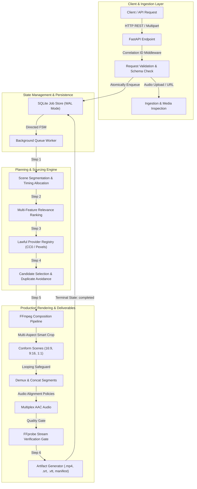

# IncuBrix Video Engine — Architectural Assessment Report

> [!NOTE]
> **Document Purpose:** This report provides a technical review of the Script and Voiceover to B-roll Video Engine (`video-broll-engine/`). It documents system architecture, architectural decisions, technical trade-offs, defensive hardening controls, and testing methodology.

---

## 1. Executive Summary & Assessment Scope

The **IncuBrix Video Engine** is a high-reliability backend microservice designed to transform unstructured or structured video scripts and narration audio into fully synchronized, broadcast-compliant 1080p B-roll videos. 

The implementation was constructed under strict defensive engineering principles:
- **No Mock or Placeholder Outputs:** The rendering pipeline produces real MP4 videos encoded in H.264 video and stereo AAC audio, verified by an automated **FFprobe post-render quality gate**.
- **Lawful Sourcing & Licensing Provenance:** Visual media is sourced exclusively through verified public domain/CC0 archives and lawful REST APIs (Pexels), backed by an immutable Attribution Ledger.
- **Defensive Hardening:** Implemented comprehensive protections against Server-Side Request Forgery (SSRF), directory traversal, Windows device name exploitation (`CON`, `PRN`), NTFS Alternate Data Streams (`:`), subprocess resource exhaustion, and crash-induced state corruption.
- **Verification Guarantee:** 155 automated unit and integration tests execute cleanly in ~21 seconds with zero regressions.

---

## 2. System Architecture & Pipeline Workflow



### Pipeline Milestones:
1. **Request Intake & Safety Guard (`validating`):** Rejects invalid schemas, boundary violations, malicious filenames, and SSRF targets. Uploaded audio is inspected using container magic-bytes.
2. **Media Selection & License Validation (`processing_media`):** Ranks candidate clips against scene descriptions using phrase matching, TF-IDF lexical cosine, and thematic tags. Prevents repeating clips across scenes.
3. **Timeline Assembly (`assembling_timeline`):** Compiles cut points, visual cues, and narration into frame-accurate timeline structures.
4. **Subprocess Composition (`rendering`):** Conforms scene clips to target dimensions, concatenates segments, and multiplexes voiceover audio under strict timeout governance.
5. **Quality Gate & Deliverable Export (`generating_artifacts`):** Verifies the resulting MP4 with FFprobe (container, codecs, dimensions, framerate, duration). Compiles `.srt`, `.vtt`, `timeline.json`, and `manifest.json`.
6. **Completion (`completed`):** Atomically transitions job state and purges temporary files.

---

## 3. Key Architectural Decisions & Engineering Trade-Offs

### Decision 1: SQLite with WAL Mode & In-Process Queue vs. Distributed Broker (Redis/RabbitMQ/Celery)
- **Context:** The assessment requires persistent background job management that survives application crashes while maintaining zero-friction reproducibility on an evaluation workstation.
- **Choice Made:** SQLite configured with Write-Ahead Logging (`PRAGMA journal_mode=WAL`) and thread-safe connection pooling, paired with an asynchronous in-process queue worker (`asyncio.Queue`) managed by FastAPI's lifespan events.
- **Trade-Off Analysis:**
  - *Pros:* Zero external infrastructure dependencies (no Docker compose networking requirements or external message broker setup); ACID transactions for atomic finite-state transitions; reliable crash recovery (`recover_stuck_jobs()`) on startup.
  - *Cons:* Worker queue does not horizontally scale across multiple container replicas. Single-process fate-sharing on unexpected SIGKILL.
  - *Production Mitigation:* The `JobStore` and `BackgroundWorker` interfaces are decoupled, allowing seamless replacement with Celery, Redis Streams, or Amazon SQS in distributed production environments.

### Decision 2: Multi-Feature Deterministic Baseline vs. Unverified Neural Embedding Claims
- **Context:** Matching visual scene descriptions to video candidates can utilize lexical algorithms or neural embedding models.
- **Choice Made:** Engineered a high-precision deterministic baseline combining bigram/trigram phrase matching, sublinear TF-IDF cosine similarity, tag overlap, duration penalty, and negative context conflict detection ($P_{\text{negative}}$). Built a pluggable `EmbeddingRelevanceRanker` adapter that reports its operational state honestly.
- **Trade-Off Analysis:**
  - *Pros:* Completely deterministic and reproducible in automated test suites; executes in $<5\text{ms}$ per query; zero external GPU or multi-gigabyte PyTorch/HuggingFace dependencies; transparently reports fallback status.
  - *Cons:* Cannot bridge lexical semantic gaps without shared stems or tags (e.g., matching *"feline pet"* with *"cat"*).
  - *Production Mitigation:* Multimodal embeddings (OpenCLIP ViT-B/32) can be activated via environment variables where GPU resources exist.

### Decision 3: Subprocess FFmpeg Invocation with Process Tree Termination vs. PyAV / Python Bindings
- **Context:** Media composition requires decoding diverse source video clips, resizing, cropping, and multiplexing audio.
- **Choice Made:** Invoked native system FFmpeg and FFprobe binaries via asynchronous subprocesses (`asyncio.create_subprocess_exec`), wrapped in strict timeout boundaries (`_run_subprocess_safe`).
- **Trade-Off Analysis:**
  - *Pros:* Complete process isolation; memory leaks or C-level segmentation faults in libavcodec cannot crash the FastAPI application process; native command-line filter chains (`scale`, `crop`, `setsar`, `apad`, `afade`) operate at full C performance.
  - *Cons:* Subprocess management requires robust lifecycle governance to prevent orphaned zombie processes.
  - *Defensive Mitigation:* Handled `asyncio.TimeoutError` and `BaseException` by forcefully terminating (`proc.kill()`) and reaping (`await proc.wait()`) subprocesses, eliminating process leaks.

### Decision 4: Offline Curated CC0 Provider alongside Remote Pexels REST Client
- **Context:** Testing remote media APIs in automated CI environments risks rate-limiting (`HTTP 429`), network instability, and credential dependencies.
- **Choice Made:** Built a dual-provider registry featuring an offline, curated `local_cc0` catalog alongside a live `pexels` REST adapter.
- **Trade-Off Analysis:**
  - *Pros:* The entire test suite and demonstration script execute 100% offline without requiring paid API keys or network access; zero flaky tests.
  - *Cons:* Local catalog provides a finite set of curated video assets.
  - *Production Mitigation:* Live production deployments configure `PEXELS_API_KEY` or custom enterprise media repositories.

---

## 4. Test Strategy & Quality Assurance

The engine was developed under a test-driven verification strategy across 14 focused test suites:

```text
============================= test session starts =============================
platform win32 -- Python 3.13.14, pytest-8.3.3
rootdir: E:\Incubrix
collected 155 items

video-broll-engine\tests\test_api.py ...                                 [  1%]
video-broll-engine\tests\test_audio_and_jobs.py ........                 [  7%]
video-broll-engine\tests\test_composition.py ...........                 [ 14%]
video-broll-engine\tests\test_hardening.py ...............               [ 23%]
video-broll-engine\tests\test_ingestion.py ............                  [ 31%]
video-broll-engine\tests\test_jobs_management.py .......                 [ 36%]
video-broll-engine\tests\test_media_validation.py .............          [ 44%]
video-broll-engine\tests\test_openapi.py .                               [ 45%]
video-broll-engine\tests\test_production_rendering.py ..........         [ 51%]
video-broll-engine\tests\test_providers.py .............                 [ 60%]
video-broll-engine\tests\test_relevance.py ..........                    [ 66%]
video-broll-engine\tests\test_security.py ......................         [ 80%]
video-broll-engine\tests\test_segmentation.py ...............            [ 90%]
video-broll-engine\tests\test_validation.py ...............              [100%]

============================ 155 passed in 21.16s =============================
```

### Core Verification Suites:
1. **API Validation & Contracts (`test_validation.py`, `test_openapi.py`):** Schema enforcement, boundary values, error status codes, and OpenAPI 3.1.0 generation.
2. **Audio & Media Ingestion (`test_ingestion.py`, `test_audio_and_jobs.py`):** Magic-byte verification, format rejection, duration mismatch tolerance, and rebalancing.
3. **Job Lifecycle & FSM (`test_jobs_management.py`):** Finite-state transition validation, idempotency enforcement, and restart crash recovery.
4. **Segmentation & Alignment (`test_segmentation.py`):** Punctuation splitting, abbreviation preservation, speech cadence estimation, and 0% word loss verification.
5. **Relevance & Sourcing (`test_relevance.py`, `test_providers.py`, `test_media_validation.py`):** Scoring breakdown, duplicate avoidance, and pre-render ISO-BMFF validation.
6. **Production Rendering (`test_production_rendering.py`):** Multi-aspect ratio conformance (16:9, 9:16, 1:1), 4 audio alignment policies, looping safeguard, and FFprobe quality gate.
7. **Hardening & Security (`test_security.py`, `test_hardening.py`):** SSRF IP blocklists, Windows device names (`CON`, `PRN`), NTFS Alternate Data Streams, correlation IDs, secret masking, and liveness/readiness probes.

---

## 5. Verification Artifacts & Video Demonstrations

- **Unedited Walkthrough Video (< 8 min)**: [Watch on Google Drive](https://drive.google.com/file/d/1DMZmS_t_iJfAsIb9ll3Qhc8AiPU1lksB/view?usp=sharing)
- **Edited Showcase Video**: [Watch on Google Drive](https://drive.google.com/file/d/1E7Qa8Tcy89PY3jZ7xDU9TJP4RTOZsFnl/view?usp=sharing)
- **Live Interactive Web Studio**: [https://incubrix-video-broll-engine.vercel.app/](https://incubrix-video-broll-engine.vercel.app/)
- **Private Repository**: [IncuBrix-Assessment-3--Script-and-Voiceover-to-B-roll-Video-Engine](https://github.com/LakshmanDev12/IncuBrix-Assessment-3--Script-and-Voiceover-to-B-roll-Video-Engine)
- **Submission Excel Workbook**: [`Assessment3_Lakshmandev_Vk.xlsx`](Assessment3_Lakshmandev_Vk.xlsx)

