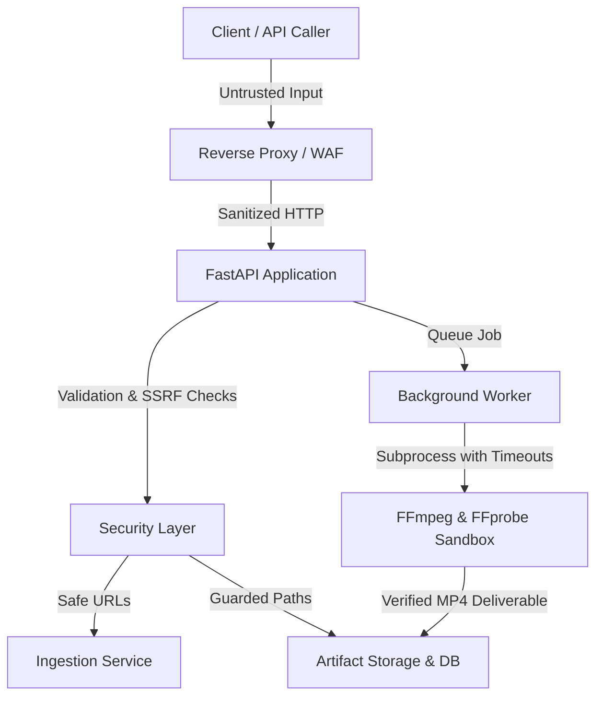

# IncuBrix Video Engine — Security Architecture & Hardening Guide

> [!IMPORTANT]
> **Audit Notice & Disclaimer:** The security controls, validations, and architectural boundaries described in this document represent **internal engineering hardening and defensive design**. No external or third-party security audit has been performed. Production deployments must review and implement the infrastructure recommendations detailed in [Section 3](#3-enterprise-production-readiness-checklist).

---

## 1. Threat Model & Architectural Boundaries

The IncuBrix Video Engine accepts untrusted external user input (video scripts, scene breakdowns, audio files, and remote audio URLs) to generate high-definition video assets. Without hardening, media processing engines present substantial attack surfaces:

### Potential Attack Vectors Mitigated:
1. **Server-Side Request Forgery (SSRF):** Exploitation of remote audio/media download endpoints to probe internal networks, VPC resources, or cloud instance metadata services (e.g., AWS/GCP IMDS).
2. **Directory & Path Traversal:** Submitting malicious filenames or traversal sequences (`../`, Windows device names, NTFS Alternate Data Streams) to access or overwrite arbitrary files on the host filesystem.
3. **Resource Exhaustion & Denial of Service (DoS):** Submitting excessively long scripts, oversized media payloads, decompression bombs, or triggering infinite FFmpeg subprocess hangs.
4. **Information Disclosure:** Leaking internal filesystem paths, environment secrets, API credentials, or Python stack traces in API error responses and log outputs.
5. **State Inconsistency & Crash Residue:** Serving incomplete or corrupted media deliverables after unexpected process restarts or failures.

---

## 2. Implemented Defense-in-Depth Safeguards

### 2.1 SSRF Protection (`app/security.py`)
- **Scheme Filtering:** Restricts URLs strictly to `http://` and `https://`. Rejects `file://`, `gopher://`, `ftp://`, `data:`, and `javascript:`.
- **Pre-Flight DNS Resolution:** Resolves target hostnames to concrete IP addresses prior to initiating socket connections.
- **Strict IP Blacklisting:**
  - Loopback addresses (`127.0.0.0/8`, `::1`).
  - RFC 1918 Private ranges (`10.0.0.0/8`, `172.16.0.0/12`, `192.168.0.0/16`).
  - Link-local and multicast addresses (`169.254.0.0/16`, `224.0.0.0/4`, `fe80::/10`).
  - Cloud Instance Metadata Service (IMDS) endpoints (`169.254.169.254`, `100.100.100.200`, `fd00:ec2::254`).
- **Redirect Governance:** Follows redirects manually, subjecting every intermediate hop to the complete SSRF and hostname verification pipeline. Maximum redirect limit is capped (`MAX_URL_REDIRECTS = 3`).
- **Probing Limits:** Sends `HEAD` or ranged `GET (bytes=0-0)` requests before full payload download to verify `Content-Length` and MIME types.

### 2.2 File System Hardening & Path Traversal Defense (`app/security.py`)
- **Directory Canonicalization:** Validates that all resolved file paths remain strictly contained within designated job directories (`Path.resolve()` boundary checks).
- **Windows DOS Reserved Device Names:** Detects and denies access to Windows legacy device names (`CON`, `PRN`, `AUX`, `NUL`, `COM1-9`, `LPT1-9`, including case variations and extensions like `CON.txt`).
- **NTFS Alternate Data Streams (ADS):** Rejects filenames containing colon characters (`:`) to prevent hidden stream execution or ACL bypasses.
- **Hidden & Dotfile Protection:** Blocks requests attempting to access hidden configuration files (`.env`, `.git`, `.htaccess`).
- **Internal State File Blacklist:** Returns `HTTP 403 Forbidden` if client requests attempt to download internal runtime files (`jobs.db`, `job_state.json`, `web.config`).

### 2.3 Resource Governance & Subprocess Sandboxing (`app/services/video_composer.py`)
- **Bounded Request Constraints:**
  - Maximum script length: 10,000 characters.
  - Maximum scenes: 30 scenes per job.
  - Scene duration bounds: 0.5s to 60.0s.
  - Job duration bounds: 1.0s to 300.0s.
  - Upload file size limit: 50MB audio, 100MB video candidate.
- **FFmpeg Subprocess Execution Governance:**
  - All FFmpeg and FFprobe processes run under asynchronous timeout boundaries (`FFMPEG_SCENE_TIMEOUT = 60s`, `FFMPEG_TOTAL_TIMEOUT = 180s`).
  - In the event of a timeout or cooperative cancellation, child processes are forcefully terminated (`proc.kill()`) and reaped (`await proc.wait()`), preventing zombie or orphaned processes from consuming host RAM and CPU.

### 2.4 Information Disclosure & Structured Observability (`app/main.py`)
- **Correlation ID Middleware:** Inspects or generates unique correlation IDs (`X-Correlation-ID`) across incoming HTTP requests, propagates them across async contexts (`contextvars`), and echoes them in response headers.
- **Secret Masking Filter:** Automatic regex-based log filter scrubs bearer authorization tokens (`Bearer [MASKED]`), API keys (`?api_key=[MASKED]`), and sensitive environment configurations before logs are written to stdout or disk.
- **Sanitized Global Error Handler:** Global exception handler intercepts unhandled runtime exceptions and returns a structured `HTTP 500` error payload containing the correlation ID, completely suppressing internal Python tracebacks and host drive paths (`C:\...`).
- **Host Path Scrubbing:** Sanitization utility cleans absolute operating system paths from error messages (`[DATA_DIR]`, `[APP_ROOT]`).

### 2.5 Health Probes & Crash Recovery (`app/main.py`, `app/storage.py`)
- **Liveness Probe (`/health/live`):** Fast heartbeat probe verifying the web server process is responsive.
- **Readiness Probe (`/health/ready`):** Deep healthcheck validating:
  1. SQLite database query responsiveness (`SELECT 1`).
  2. Output directory filesystem write access.
  3. Available host disk space $\ge 500\text{MB}$ (`MIN_DISK_FREE_BYTES`).
  4. Media binary availability (`ffmpeg` and `ffprobe`).
  5. Background queue runner status.
- **Crash Recovery & Partial Output Purge:** During server startup, interrupted jobs left in `running` state are re-queued with retry backoff. Corrupted partial outputs (`video.mp4`, `temp/` scene chunks) are automatically purged from disk before jobs re-execute.

---

## 3. Enterprise Production Readiness Checklist

While the current architecture provides robust defensive controls for self-contained assessment environments, enterprise production deployments require the following infrastructure-level enhancements:

| Domain | Assessment Baseline | Enterprise Production Requirement |
| :--- | :--- | :--- |
| **Queue & Worker** | In-process `asyncio.Queue` | Distributed message broker (RabbitMQ, Redis Streams, or Celery) running on isolated worker pools. |
| **Artifact Storage** | Host filesystem (`output/`) | Cloud object storage (AWS S3, Google Cloud Storage, Cloudflare R2) with short-lived presigned URLs. |
| **Media Egress** | Direct HTTPX with IP validation | Dedicated forward egress proxy (Squid, Envoy) with network firewall egress rules blocking internal subnets. |
| **Process Isolation** | OS-level subprocess (`asyncio.create_subprocess_exec`) | Container sandboxes (Docker, gVisor / runsc, Kubernetes Jobs) with resource limits (`cgroups`, seccomp). |
| **Secrets Management** | `.env` file | Centralized secret vault (HashiCorp Vault, AWS Secrets Manager, GCP Secret Manager) with automatic rotation. |
| **Traffic Governance** | Application middleware | Edge Web Application Firewall (Cloudflare WAF, AWS WAF) with DDoS mitigation and token bucket rate limiting. |
| **Database** | SQLite with WAL mode | Managed relational database (PostgreSQL with read replicas, Amazon RDS, Google Cloud SQL). |

---

## 4. Security Verification & Test Coverage

All security controls are verified by automated regression test suites:

- `tests/test_security.py`: Comprehensive SSRF suite, forbidden schemes, cloud metadata IP protection, private subnets.
- `tests/test_hardening.py`: Windows reserved device names (`CON`, `PRN`), NTFS Alternate Data Streams (`:`), hidden dotfiles, internal state blacklist (`jobs.db`), correlation ID propagation, secret log masking, unhandled 500 error sanitization, readiness storage thresholds, FFmpeg timeout subprocess termination, and crash recovery artifact purging.

All 155 test cases across 14 modules pass unconditionally in the continuous verification suite.
